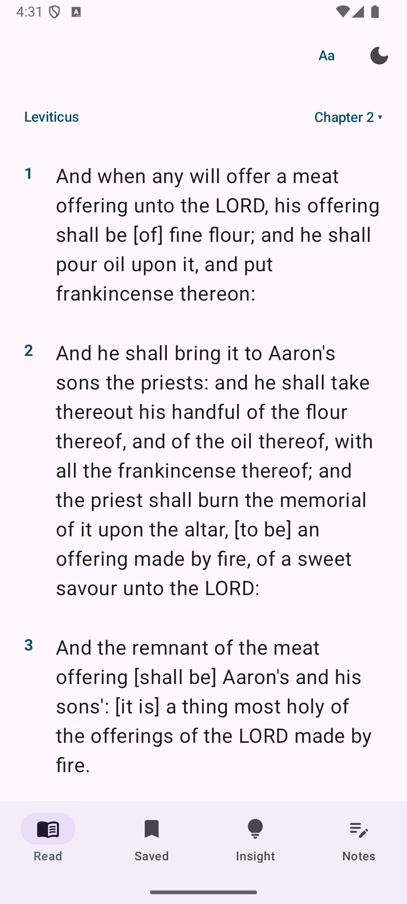
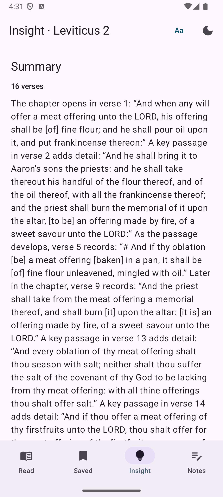

# KJVFoss

## About

KJVFoss is a native Android King James Version (KJV) Bible app built with Kotlin, Jetpack Compose, and Material 3.
It reads the bundled KJV text locally and is designed to work entirely offline, without an internet permission or external network services.
Its purpose is to offer a quiet reader and practical study tools while keeping personal data on the device.

## Features

- Read chapters by book, adjust text size, and switch between light and dark themes.
- Highlight or bookmark verses, copy verses or references, and browse saved passages.
- Insight presents a chapter-focused, text-based summary and key verses without external commentary.
- Old Testament Insight maps selected KJV words to a local Hebrew-root list, while New Testament Insight uses Koine Greek mappings; these are study aids, not a complete concordance.
- Create, edit, filter, and delete study notes, optionally linked to a book and chapter.
- The app remembers the last-read book and chapter. Bookmarks and highlights use DataStore, while notes are stored locally with Room.
- Build the debug APK with `./gradlew :app:assembleDebug`.

## Screenshots

  
  

